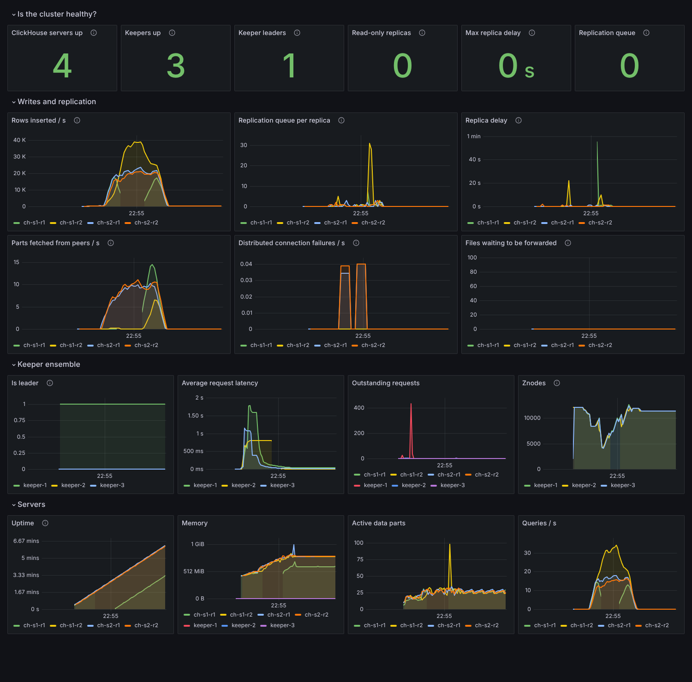
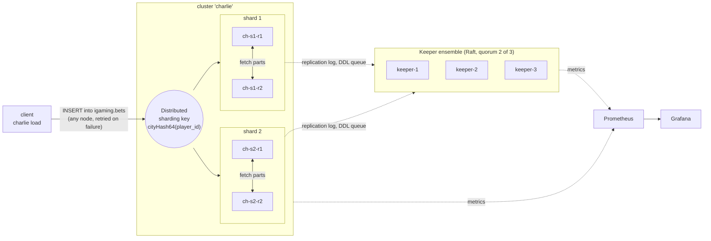

# Charlie · a highly available ClickHouse cluster, described as code

A production-shaped ClickHouse cluster that runs on a laptop with one command: **2 shards x
2 replicas**, coordinated by a **3-node ClickHouse Keeper** ensemble. The shape of the cluster
lives in one file, `topology.yaml`; everything else (compose file, server and Keeper configs,
Prometheus scrape config) is generated from it, and CI fails if the generated files drift.

The point is not that it starts. The point is that it is **tested the way it would be broken in
production**: replicas and Keepers are killed under load, and every drill ends by proving that
each acknowledged row exists exactly once and that all replicas hold identical data.



## What it shows

| Area | How it is done here |
| --- | --- |
| Cluster as code | `topology.yaml` is validated (odd Keeper count, no port clashes) and rendered by `charlie render` into `deploy/`. `charlie check` and CI fail on any hand edit |
| Replication | `ReplicatedMergeTree` per shard, `internal_replication = true`, so a write goes to one replica and the cluster copies it |
| Sharding | One `Distributed` table, rows routed by `cityHash64(player_id)`: a player always lives on one shard |
| Coordination | 3 Keepers (quorum 2), Raft; the cluster keeps writing with one Keeper down and keeps reading with two down |
| Schema management | Ordered `NNN_name.sql` migrations with `ON CLUSTER`, applied once and tracked with checksums in a table replicated to every node. Editing an applied migration is refused |
| Safe retries | Batches are deterministic, so a retry after a failure is an identical block and ClickHouse deduplicates it. That is what makes exact-count assertions possible |
| Inter-node trust | Distributed queries run as the calling user over a shared `secret`, so no passwords are stored in the cluster definition. Secrets come from the environment (`from_env`) and are never rendered into files |
| Observability | Every server and Keeper exposes Prometheus metrics; one dashboard answers "is the cluster healthy?" in six numbers |
| Failure drills | Six scripted drills run in CI against the real containers (below) |

## Architecture



Replicas never talk to each other about *what* to copy; they agree through Keeper (a log of
inserts and merges per table) and then fetch the parts they miss directly from a sibling. That is
why losing Keeper stops **writes** but not **reads**, while losing a ClickHouse replica stops
nothing as long as its sibling is up.

## Run it

Requirements: Docker with Compose v2, about 4 GB RAM free, Python 3.11+.

```bash
make dev && . .venv/bin/activate   # the `charlie` command
make up       # 3 Keepers, 4 ClickHouse servers, Prometheus, Grafana; applies the schema
make load     # 100k rows through the Distributed table
make status   # keeper roles, replica health, rows per replica
make verify   # totals, duplicates, replica equality, shard balance
make drill    # kill a replica and a Keeper under load, then prove nothing was lost
make clean    # stop and delete all data
```

| UI | URL |
| --- | --- |
| Grafana, dashboard *Charlie / Cluster health* (anonymous viewer; admin/admin) | http://localhost:3000 |
| Prometheus | http://localhost:9090 |
| ClickHouse Play, one port per node (admin / charlie) | http://localhost:8123/play ... 8126 |

```text
$ make status
keeper ensemble (3 nodes, quorum 2)
  keeper-1   up   follower  znodes=13
  keeper-2   up   follower  znodes=13
  keeper-3   up   leader    znodes=13 followers=2
clickhouse (2 shards x 2 replicas)
  ch-s1-r1  up   keeper=ok readonly_tables=0 queue=0 delay=0s rows=99936
  ch-s1-r2  up   keeper=ok readonly_tables=0 queue=0 delay=0s rows=99936
  ch-s2-r1  up   keeper=ok readonly_tables=0 queue=0 delay=0s rows=100064
  ch-s2-r2  up   keeper=ok readonly_tables=0 queue=0 delay=0s rows=100064
```

### Change the shape

Edit `topology.yaml` (say `shards: 3`), then `make render`. The compose file, every
`macros.xml`, the `remote_servers` section, the Keeper Raft membership and the Prometheus
targets are regenerated together; files of removed nodes are deleted. Existing data does not
move by itself: adding a shard to a live cluster needs a rebalancing step that is out of scope here.

## Failure drills

`make e2e` runs these against the live cluster (about 6 minutes; also the `e2e` CI job). After
each one, `check_consistency` asserts: the cluster holds **exactly** the acknowledged rows, no
`bet_id` twice, both replicas of a shard have identical counts, shards are balanced.

| Drill | What is broken | What the test proves |
| --- | --- | --- |
| Baseline | nothing | rows spread over both shards and are identical on both replicas |
| Replica down | `ch-s1-r1` stopped, load continues | inserts fail over to the sibling with no failed batch; reads through any node see every acknowledged row; the revived replica catches up by fetching parts |
| One Keeper down | `keeper-1` stopped | 2 of 3 is still a quorum: writes continue, no data loss |
| Quorum lost | `keeper-2` and `keeper-3` stopped | replicas turn **read-only** after the session timeout; reads still work; writes are refused and nothing half-written is acknowledged; after recovery the same batches are accepted exactly once |
| Whole shard down | both replicas of shard 1 stopped | by default a query **fails loudly**; with `skip_unavailable_shards = 1` it returns a **silently partial** answer. Both behaviours are asserted, because the second is a trap |
| Rolling restart | every server restarted in turn, one at a time, under load | **zero failed batches**, nothing lost or duplicated |

`make drill` is the same idea as a narrated demo: kill a replica, then a Keeper, then revive
both, while the dashboard above updates. A run on the 4-vCPU test machine:

```text
[21:59:41] load started
[22:00:01] killing replica ch-s1-r1
[22:00:38] killing keeper-2 (2 of 3 keepers left, still a quorum)
[22:01:10] reviving keeper-2 and ch-s1-r1
[22:01:52] load finished: 4750000 rows acknowledged, 532 retries, 0 failed batches
[22:01:54] total=9022000 unique=9022000 per node={'ch-s1-r1': 4509390, 'ch-s1-r2': 4509390, 'ch-s2-r1': 4512610, 'ch-s2-r2': 4512610}
```

4.75 million rows acknowledged during 130 seconds that included two failures (about 36k rows/s
on one small machine with all seven containers on it), 532 client retries absorbed, none lost,
none duplicated, replicas identical to the row.

## Design notes and trade-offs

- **An insert is acknowledged after one replica has it.** The default is availability: with
  `insert_quorum` unset the write succeeds as soon as one replica of each shard holds it, and
  the sibling fetches it afterwards. If that replica's disk is destroyed in the gap, those rows
  are gone. `insert_quorum = 2` closes the gap and makes the shard refuse writes while a replica
  is down. This repo keeps the default and says so, rather than hiding the choice.
- **Synchronous Distributed inserts** (`insert_distributed_sync = 1`) in the load generator, so an
  HTTP 200 means the rows reached the shards. The default asynchronous mode acknowledges once the
  rows are on the receiving node's disk, which is faster but weaker.
- **An even Keeper count is rejected.** Four Keepers tolerate one failure, like three, and can
  split into two halves of two. `topology.yaml` validation refuses it.
- **Keeper waits for its peers' DNS names** in the compose entrypoint. Keeper refuses to start
  while a peer name does not resolve and Docker DNS only knows running containers, so without
  this the three crash-loop at first boot.
- **IPv6 is off for Raft** (`enable_ipv6 = false`) so Keeper starts on IPv4-only hosts.
- **Grafana does not phone home**, which also keeps its UI from stalling where egress is blocked.
- Default credentials (`admin` / `charlie`) are for the local demo. They are read from
  `CH_ADMIN_PASSWORD`, and the interserver secret from `CH_INTERSERVER_SECRET`.
  Real deployments inject both from a secret store.

## Repository map

```text
topology.yaml              the cluster shape: single source of truth
src/charlie/topology.py    validated model (odd Keepers, port clashes, naming)
src/charlie/render.py      topology -> deploy/ (pure, deterministic)
templates/                 Jinja templates for compose, Keeper, macros, remote_servers, Prometheus
config/                    static server settings and the bootstrap admin
deploy/                    GENERATED. CI fails if it differs from the topology
schema/migrations/         ordered, checksummed, ON CLUSTER SQL
src/charlie/migrate.py     the migration runner
src/charlie/loadgen.py     deterministic, retry-safe load generator
src/charlie/status.py      health and consistency checks
tests/                     unit tests, and tests/e2e: the failure drills
grafana/build_dashboards.py  dashboards as code
```

## Develop

```bash
make dev && . .venv/bin/activate
make test lint
make dashboards   # rebuild grafana/dashboards/*.json from grafana/build_dashboards.py
make check        # deploy/ must match topology.yaml
```

Unit tests need no Docker (35 of them: topology validation, rendered XML, migration logic,
deterministic batches). CI runs them, then starts the cluster and runs every drill.

## Next

Roles, users, quotas and row policies as code across ClickHouse and PostgreSQL, with group
mapping from LDAP; then backups to object storage, restore drills and rolling upgrades.
