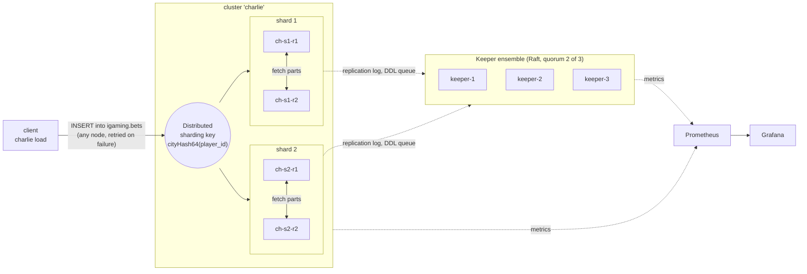

# Charlie · a highly available ClickHouse cluster, described as code

A production-shaped ClickHouse cluster that runs on a laptop with one command: **2 shards x
2 replicas**, coordinated by a **3-node ClickHouse Keeper** ensemble. The shape of the cluster
lives in one file, `topology.yaml`; everything else (compose file, server and Keeper configs,
Prometheus scrape config) is generated from it, and CI fails if the generated files drift.

The point is not that it starts. The point is that it is **tested the way it would be broken in
production**: replicas and Keepers are killed under load, and every drill ends by proving that
each acknowledged row exists exactly once and that all replicas hold identical data.


## What it shows

| Area | How it is done here |
| --- | --- |
| Cluster as code | `topology.yaml` is validated (odd Keeper count, no port clashes) and rendered by `charlie render` into `deploy/`. `charlie check` and CI fail on any hand edit |
| Replication | `ReplicatedMergeTree` per shard, `internal_replication = true`, so a write goes to one replica and the cluster copies it |
| Sharding | One `Distributed` table, rows routed by `cityHash64(player_id)`: a player always lives on one shard |
| Coordination | 3 Keepers (quorum 2), Raft; the cluster keeps writing with one Keeper down and keeps reading with two down |
| Schema management | Ordered `NNN_name.sql` migrations with `ON CLUSTER`, applied once and tracked with checksums in a table replicated to every node. Editing an applied migration is refused |
| Safe retries | Batches are deterministic, so a retry after a failure is an identical block and ClickHouse deduplicates it. That is what makes exact-count assertions possible |
| Inter-node trust | Distributed queries run as the calling user over a shared `secret`, so no passwords are stored in the cluster definition. Secrets come from the environment (`from_env`) and are never rendered into files |
| Observability | Every server and Keeper exposes Prometheus metrics; one dashboard answers "is the cluster healthy?" in six numbers |
| Failure drills | Six scripted drills run in CI against the real containers (below) |
| Benchmarks | `charlie bench` in a scratch database: batch size, the price of `insert_quorum = 2`, query cost of distribution, shard pruning, replica convergence; reported as ratios on shared hardware ([Benchmarks](#benchmarks)) |
| Rolling upgrade | Change `images` in `topology.yaml`, `charlie render`, `charlie upgrade`: Keepers (leader last) then servers, one at a time, each waiting for Keeper and an empty replication queue. CI upgrades 24.3 to 24.8 while writing and reading ([Rolling upgrade](#rolling-upgrade)) |
| Backups | `charlie backup create / list / restore / drill`: full and incremental `BACKUP ... ON CLUSTER` to S3-compatible storage, credentials only in server config. The drill drops every database, restores, and compares row counts and content hashes ([Backups and restore](#backups-and-restore)) |
| Access as code | One reviewed `access/model.yaml` becomes roles, grants, row policies, quotas and settings profiles in **ClickHouse and PostgreSQL**. `charlie access plan / apply / drift`; people come from LDAP groups, and leaving a group removes access in both databases ([Access as code](#access-as-code)) |

## Architecture



Replicas never talk to each other about *what* to copy; they agree through Keeper (a log of
inserts and merges per table) and then fetch the parts they miss directly from a sibling. That is
why losing Keeper stops **writes** but not **reads**, while losing a ClickHouse replica stops
nothing as long as its sibling is up.

## Run it

Requirements: Docker with Compose v2, about 4 GB RAM free, Python 3.11+.

```bash
make dev && . .venv/bin/activate   # the `charlie` command
make up       # 3 Keepers, 4 ClickHouse servers, PostgreSQL, LDAP, MinIO, Prometheus, Grafana; applies the schema
make backup   # full backup of every database to MinIO; `make backup-drill` destroys and restores
make access   # seed the demo directory and apply access/model.yaml to both databases
make load     # 100k rows through the Distributed table
make status   # keeper roles, replica health, rows per replica
make verify   # totals, duplicates, replica equality, shard balance
make drill    # kill a replica and a Keeper under load, then prove nothing was lost
make clean    # stop and delete all data
```

| UI | URL |
| --- | --- |
| Grafana, dashboard *Charlie / Cluster health* (anonymous viewer; admin/admin) | http://localhost:3000 |
| Prometheus | http://localhost:9090 |
| ClickHouse Play, one port per node (admin / charlie) | http://localhost:8123/play ... 8126 |

```text
$ make status
keeper ensemble (3 nodes, quorum 2)
  keeper-1   up   follower  znodes=13
  keeper-2   up   follower  znodes=13
  keeper-3   up   leader    znodes=13 followers=2
clickhouse (2 shards x 2 replicas)
  ch-s1-r1  up   keeper=ok readonly_tables=0 queue=0 delay=0s rows=99936
  ch-s1-r2  up   keeper=ok readonly_tables=0 queue=0 delay=0s rows=99936
  ch-s2-r1  up   keeper=ok readonly_tables=0 queue=0 delay=0s rows=100064
  ch-s2-r2  up   keeper=ok readonly_tables=0 queue=0 delay=0s rows=100064
```

### Change the shape

Edit `topology.yaml` (say `shards: 3`), then `make render`. The compose file, every
`macros.xml`, the `remote_servers` section, the Keeper Raft membership and the Prometheus
targets are regenerated together; files of removed nodes are deleted. Existing data does not
move by itself: adding a shard to a live cluster needs a rebalancing step that is out of scope here.

## Failure drills

`make e2e` runs these against the live cluster (about 6 minutes; also the `e2e` CI job). After
each one, `check_consistency` asserts: the cluster holds **exactly** the acknowledged rows, no
`bet_id` twice, both replicas of a shard have identical counts, shards are balanced.

| Drill | What is broken | What the test proves |
| --- | --- | --- |
| Baseline | nothing | rows spread over both shards and are identical on both replicas |
| Replica down | `ch-s1-r1` stopped, load continues | inserts fail over to the sibling with no failed batch; reads through any node see every acknowledged row; the revived replica catches up by fetching parts |
| One Keeper down | `keeper-1` stopped | 2 of 3 is still a quorum: writes continue, no data loss |
| Quorum lost | `keeper-2` and `keeper-3` stopped | replicas turn **read-only** after the session timeout; reads still work; writes are refused and nothing half-written is acknowledged; after recovery the same batches are accepted exactly once |
| Whole shard down | both replicas of shard 1 stopped | by default a query **fails loudly**; with `skip_unavailable_shards = 1` it returns a **silently partial** answer. Both behaviours are asserted, because the second is a trap |
| Rolling restart | every server restarted in turn, one at a time, under load | **zero failed batches**, nothing lost or duplicated |

`make drill` is the same idea as a narrated demo: kill a replica, then a Keeper, then revive
both, while the dashboard above updates. A run on the 4-vCPU test machine:

```text
[21:59:41] load started
[22:00:01] killing replica ch-s1-r1
[22:00:38] killing keeper-2 (2 of 3 keepers left, still a quorum)
[22:01:10] reviving keeper-2 and ch-s1-r1
[22:01:52] load finished: 4750000 rows acknowledged, 532 retries, 0 failed batches
[22:01:54] total=9022000 unique=9022000 per node={'ch-s1-r1': 4509390, 'ch-s1-r2': 4509390, 'ch-s2-r1': 4512610, 'ch-s2-r2': 4512610}
```

4.75 million rows acknowledged during 130 seconds that included two failures (about 36k rows/s
on one small machine with all seven containers on it), 532 client retries absorbed, none lost,
none duplicated, replicas identical to the row.

## Access as code

Who may do what is the part of a database that rots fastest: a `GRANT` typed during an
incident, a leaver nobody revoked, a role that means something different in each engine.
Here it is one file, reviewed like code, compiled for both engines and compared with reality.

```yaml
# access/model.yaml (abridged)
levels:                       # a role is <domain>_<level>; nothing else is accepted
  ro:    { clickhouse: [SHOW, SELECT], postgres: [SELECT], profile: analyst, quota: analyst_daily }
  rw:    { clickhouse: [SHOW, SELECT, INSERT], postgres: [SELECT, INSERT, UPDATE], profile: writer }
domains:                      # a business area and what it owns in each engine
  igaming: { clickhouse: { databases: [igaming] }, postgres: { schemas: [igaming] } }
  finance: { clickhouse: { databases: [finance] }, postgres: { schemas: [finance] } }
scoped_roles:                 # a base role restricted to some rows
  - { name: igaming_ro_aurora, base: igaming_ro, row_policies: { igaming.bets_local: "brand = 'aurora'" } }
service_accounts:             # the only accounts with a password in the database
  svc_loader: { roles: [igaming_rw], password_env: SVC_LOADER_PASSWORD }
```

Two domains and three levels give six roles in each engine; `charlie access plan` expands the
file into 62 ClickHouse objects (roles, grants, memberships, three row policies, two settings
profiles, a quota) and 82 PostgreSQL ones, and a plan against a cluster that is already right
takes about a second for both engines.

```text
$ charlie access drift                 # someone ran GRANT SELECT ON finance.* TO igaming_ro by hand
== clickhouse
   - grant SELECT ON finance.* TO igaming_ro   (configured, but not in the model)
   0 to add, 0 to change, 1 not in the model

configured access differs from access/model.yaml          # exit code 1
$ charlie access apply                 # adds are applied, removals are not
   1 removals skipped: run with --prune to delete what the model lacks
$ charlie access apply --prune
  REVOKE SELECT ON finance.* FROM `igaming_ro`
```

**How it works.** Each engine's adapter reduces both sides to a set of *facts* (kind, key,
attributes): the model on one side, `SHOW GRANTS` and the `system.*` tables (or the PostgreSQL
catalog) on the other. The diff is engine-neutral; the adapter turns each difference into SQL.
Additions run before removals so a swap never leaves a gap, and removals need `--prune` because
deleting is the dangerous half. PostgreSQL runs the whole plan in one transaction; ClickHouse DDL
is not transactional, so a failed apply is simply re-run, which is safe because every statement
is idempotent. In ClickHouse, access entities live in Keeper (`user_directories` with a
`replicated` storage), so a role created on one node exists on all four without `ON CLUSTER`.
Anything in that storage which the model does not mention is drift, including privilege kinds the
model cannot express (`WITH GRANT OPTION`), which are reported rather than silently ignored.

**People come from the directory, not from the file.** A real deployment points at authentik,
Keycloak (LDAP provider), FreeIPA or Active Directory; the stand uses an OpenLDAP container,
which looks the same from the database's side. Membership of the group `db_igaming_ro` means the
role `igaming_ro`. `charlie access apply` reads the groups and creates or removes, in both
databases, a login for each person and the memberships that follow from their groups:

| | ClickHouse | PostgreSQL |
| --- | --- | --- |
| Person | `CREATE USER bob IDENTIFIED WITH ldap SERVER 'directory'` | `LOGIN` role with no password; `pg_hba.conf` sends everyone but `svc_*` to LDAP |
| Group `db_x` | `GRANT x TO bob` | `GRANT x TO bob` |
| Leaves a group | membership revoked | membership revoked |
| Leaves the company | user dropped | role dropped, open sessions terminated first |

The directory is the authority on people, so these removals do **not** need `--prune`. The delay
between a change in the directory and a change in the databases is the interval at which `apply`
runs (a cron job, a CI schedule or an IdP webhook); a deleted or disabled account fails to log in
immediately, because the password is checked against LDAP every time. The offboarding drill
(`tests/e2e/test_access.py`) removes a person from the directory, applies, and asserts that the
person's open PostgreSQL session is gone and that neither database knows the name any more.

**What was found on the way** (each has a test or a guard):

- **A row policy on a Distributed table does nothing.** The shards run the query as the calling
  user and never see the policy, so every row comes back. It has to be on the table that stores
  the data (`bets_local`). `charlie access plan` refuses a policy on a Distributed table.
- **Once a table has any row policy, users matched by none of them see nothing.** Every
  restricted table therefore also gets a generated `allow_all` policy `TO ALL EXCEPT` the
  scoped roles.
- **Two scoped roles on one person give the union of their rows**, not the intersection, which
  is why the model says "give people one or the other".
- **An LDAP *user directory* breaks Distributed queries.** Those users only exist on the node they
  logged in to; the other shards, which receive the query over the interserver secret, answer
  `Unable to map external roles`. LDAP-authenticated SQL users exist everywhere, and Distributed
  queries as an LDAP user work on every node (tested on all four).
- **ClickHouse looks up a user's groups with the user's own LDAP bind**, so the directory has to
  let signed-in users read the group branch. That ACL is generated into `deploy/ldap/`.
- **Group privileges such as `ALL` or `CREATE` are not accepted** in the model: the server prints
  them expanded, so they could never be compared. Privileges are an explicit whitelist.
- **Passwords are not diffed.** Only the kind of authentication is compared; rotating a service
  password is a deliberate act. Secrets come from the environment, never from the model, and are
  redacted in what `plan` and `apply` print.

Try it: `make up access`, then `charlie directory show`, `charlie access drift`, and log in as
`bob` / `bob-pass` on `localhost:8123` (ClickHouse) or `localhost:5432/app` (PostgreSQL). The demo
people are in `fixtures/directory/people.yaml`; their passwords are demo-only.

## Backups and restore

A backup nobody has restored is a hope, so the interesting part is the drill, not the `BACKUP`
statement. `charlie backup drill` (also run by CI) does this against the live cluster:

1. load rows, record a fingerprint (row count and a hash over every column, per database), take a
   **full** backup to the object store;
2. load more rows, take an **incremental** backup on top of the full one;
3. `DROP DATABASE ... SYNC` for every database, which also removes their metadata from Keeper;
4. `RESTORE` the incremental backup, `SYSTEM SYNC REPLICA` everywhere, and assert that the
   fingerprint, replica equality and the absence of duplicates match the moment of the backup;
5. destroy again and restore the **full** backup, to show that an older point in time comes back
   as exactly the older data.

```text
$ charlie backup drill --rows 1000000
loading 1000000 rows
full backup full-20261103-094342: 1.4s, 36,344,557 bytes
loading 500000 more rows
incremental backup incr-20261103-094342: 0.9s, 19,572,037 bytes
destroying the databases, restoring incr-20261103-094342
  restored in 1.2s: bets=2500000 hash=e08974c2f832c8c9 ledger=25000 hash=d523b7929eb82767 migrations=2
destroying the databases, restoring full-20261103-094342
  restored in 1.0s: bets=2000000 hash=f113d079962ec85b ledger=20000 hash=9eb6d698f643e08c migrations=2
restore drill: OK
```

What the numbers say, and what they do not:

- **The bucket holds each row once, not once per replica.** With `ON CLUSTER`, one replica per
  shard writes its parts. For 1M rows the cluster holds 36.1 MB across four replicas; the backup
  is 18.2 MB, 1.01x one copy. Parts are copied as they are on disk, already compressed.
- **Increments are per part, not per row.** A backup of an unchanged cluster is 106 KB of
  metadata, and 50k new rows cost about 3 MB. But when a background merge has combined old and new
  parts into a new part, that part is uploaded again, which is why 500k new rows above cost
  19.6 MB (a full copy is 36 MB), not a proportional 9 MB.
- **The times are for a laptop and a MinIO container on the same Docker network.** A restore in
  about a second says the mechanism works, not that a terabyte restores in a second. Plan
  recovery time from the bandwidth to the bucket, not from this table.
- **The `BACKUP` statement carries no credentials.** The bucket's keys are in the server config
  (`<s3>`, matched by URL prefix, read from the environment), so nothing sensitive reaches
  `query_log`; a test greps for it.
- **Access control is not in the backup on purpose.** Users, roles and policies are rebuilt by
  `charlie access apply` from the reviewed model and the directory. The drill asserts that
  `charlie access drift` is clean after the restore, including the row policies on the tables
  that were dropped and re-created.
- **The restore target must not contain the databases.** `RESTORE` refuses to overwrite, which
  is the safe default. The schema-migration history (`charlie_meta`) is part of the backup, so a
  restored cluster knows which migrations ran and `charlie migrate --plan` says nothing is pending.

`make up` starts MinIO (console on http://localhost:9101, `charlie` / `charlie-secret`);
`make backup` takes a backup, `make backup-drill` runs the drill. Point `topology.yaml`'s
`minio` block at real S3 for anything else.

## Benchmarks

`charlie bench` runs in a scratch database that it creates and drops, so it never touches the demo
data. Full results, with the machine they were measured on, are in
[docs/benchmarks.md](docs/benchmarks.md). The whole cluster, the load generator and Prometheus
share 4 cores here, so read the **ratios**, not the absolute numbers; each row is one 15-second
run, and two full runs of `charlie bench` differed by 10-30% in individual rows (the approximate
distinct count went from 1.8x to 2.5x). Conclusions that hold in both runs are the ones above.

| Question | Result |
| --- | --- |
| What does a bigger insert batch buy? | 1k rows: 30k rows/s; 5k: 59k; 20k: 72k; 100k: 70k. Throughput stops improving around 20k rows per batch while batch latency keeps growing (p50 0.5 s at 20k, 1.6 s at 100k). Tiny batches cost half the throughput |
| What does `insert_quorum = 2` cost? | 55k rows/s without, 48k with (-13%), batch p50 193 ms to 266 ms. Cheap here because replicas share a host; over a real network the second acknowledgement costs a round trip |
| Do replicas keep up? | After a 1.0M-row burst all four replicas had everything 0.29 s later |
| What does distribution cost? | 2x the data (both shards) against one shard: a full-scan aggregate takes 1.93x as long, so the coordination overhead is small, and there is **no speed-up** because the shards share the same cores. On separate machines that ratio should fall towards 1x. I have not measured that |
| Which query is expensive to distribute? | `uniqExact` is 3.4x (every shard ships its exact set of player ids to the initiator); the approximate `uniq` is 2.5x. A query that is already fast, like the last-day top 10 (partition pruning), is 1.45x |
| Does the sharding key help lookups? | A player lookup with `optimize_skip_unused_shards = 1` reads 5.0M rows instead of 10.0M and takes 41 ms instead of 66 ms |

Two things the numbers point at rather than fix. The pruned lookup still scans a whole shard
because the table is ordered by `(brand, game, ts, bet_id)`, not by player; a projection or a
second table ordered by `player_id` is the answer if that query matters. And the quorum result
says what the setting costs when nothing is wrong; what it buys (writes refused instead of
under-replicated while a replica is down) is shown by the failure drills.

## Rolling upgrade

The upgrade is a diff and a command. Change `images` in `topology.yaml`, run `charlie render`
(the change to `deploy/` is the review), then `charlie upgrade`:

- **Keepers first, followers before the leader.** Upgrading the coordination layer before its clients is the
  safe order, and the quorum of two survives one Keeper restarting at a time.
- **Then ClickHouse, one server at a time**, replica 2 of every shard before replica 1. A step is
  finished only when the container is healthy, connected to Keeper, not read-only, and has an
  empty replication queue; otherwise the next restart could take down the replica that has the
  data the other is still fetching.
- **It is idempotent.** Servers already on the target image are skipped, so a failed run is simply
  run again.
- **It checks itself.** While it works, four writers insert and a reader queries with failover; at
  the end it asserts that every acknowledged row exists exactly once and all replicas are equal.

```text
$ sed -i 's/:24.3/:24.8/' topology.yaml && charlie render && charlie upgrade
7 of 7 servers need the new image
  keeper-2: clickhouse/clickhouse-keeper:24.3 -> clickhouse/clickhouse-keeper:24.8 in 78s
  keeper-3: ... in 47s
  keeper-1: ... in 42s
  ch-s1-r2: clickhouse/clickhouse-server:24.3 -> clickhouse/clickhouse-server:24.8 in 24s
  ch-s2-r2: ... in 14s
  ch-s1-r1: ... in 16s
  ch-s2-r1: ... in 14s
servers: 24.3.18.7 -> 24.8.14.39 in 240s
under load: 7,048,000 rows written, 697 retries, 0 lost batches; 605 reads, 0 failed
```

That run is 24.3 LTS to 24.8 LTS on a 2x2 cluster with 3 Keepers on a laptop, writing about
29,000 rows/s throughout. What it shows and what it does not:

- **No acknowledged write was lost and no read failed** (reads fail over between nodes, as an
  application's client would). The 697 retries are the cost: writes that landed on a node during
  its restart were retried against another one, with the same deterministic batch, so the
  deduplication window makes them exactly-once.
- **A server takes 14-24 s, a Keeper 42-78 s.** The Keeper step is slower because its readiness
  condition is cluster-wide: every server must reconnect to Keeper and drain its queue while the
  load keeps coming. Do not read the numbers as a production estimate: data
  volume decides how long a replica needs to catch up.
- **It upgrades one version line, not several.** Skipping LTS releases needs the release notes'
  intermediate stops, not a longer command. The drill tests the realistic hop.
- **No rollback is promised.** Downgrading a ClickHouse data directory is not generally
  supported, so the safety net is the previous section: take a backup, and have restored one.

CI runs this as its own job: it starts the *old* images, loads data, switches `topology.yaml` to
the new ones and upgrades under load (`make upgrade` does the last step locally).

## Design notes and trade-offs

- **An insert is acknowledged after one replica has it.** The default is availability: with
  `insert_quorum` unset the write succeeds as soon as one replica of each shard holds it, and
  the sibling fetches it afterwards. If that replica's disk is destroyed in the gap, those rows
  are gone. `insert_quorum = 2` closes the gap and makes the shard refuse writes while a replica
  is down. This repo keeps the default and says so, rather than hiding the choice.
- **Reads can be briefly stale.** A query through the Distributed table reads one replica per
  shard, and a replica that has just restarted may not have fetched the newest parts yet
  (`max_replica_delay_for_distributed_queries` decides when ClickHouse avoids a lagging one).
  The consistency check therefore runs `SYSTEM SYNC REPLICA` on every node before it counts;
  an earlier version of the rolling-restart drill failed in CI for exactly this reason, with
  all rows stored and the total read from a lagging replica. For read-your-writes use
  `insert_quorum` together with `select_sequential_consistency = 1`.
- **Synchronous Distributed inserts** (`insert_distributed_sync = 1`) in the load generator, so an
  HTTP 200 means the rows reached the shards. The default asynchronous mode acknowledges once the
  rows are on the receiving node's disk, which is faster but weaker.
- **An even Keeper count is rejected.** Four Keepers tolerate one failure, like three, and can
  split into two halves of two. `topology.yaml` validation refuses it.
- **Keeper waits for its peers' DNS names** in the compose entrypoint. Keeper refuses to start
  while a peer name does not resolve and Docker DNS only knows running containers, so without
  this the three crash-loop at first boot.
- **Servers get 60 s to stop** (`stop_grace_period`) instead of Docker's default 10 s, so a
  loaded node finishes a clean shutdown during a rolling restart rather than being killed.
- **IPv6 is off for Raft** (`enable_ipv6 = false`) so Keeper starts on IPv4-only hosts.
- **Grafana does not phone home**, which also keeps its UI from stalling where egress is blocked.
- Default credentials (`admin` / `charlie`) are for the local demo. They are read from
  `CH_ADMIN_PASSWORD`, and the interserver secret from `CH_INTERSERVER_SECRET`.
  Real deployments inject both from a secret store.

## Repository map

```text
topology.yaml              the cluster shape: single source of truth
src/charlie/topology.py    validated model (odd Keepers, port clashes, naming)
src/charlie/render.py      topology -> deploy/ (pure, deterministic)
templates/                 Jinja templates for compose, Keeper, macros, remote_servers, Prometheus
config/                    static server settings and the bootstrap admin
deploy/                    GENERATED. CI fails if it differs from the topology
schema/migrations/         ordered, checksummed, ON CLUSTER SQL
src/charlie/bench.py       benchmarks in a scratch database (docs/benchmarks.md is their output)
src/charlie/upgrade.py     rolling upgrade with its own consistency check
src/charlie/backup.py      backup / restore / restore drill
access/model.yaml          roles, scoped roles, profiles, quotas, service accounts
src/charlie/access/        model -> facts -> diff -> SQL for ClickHouse and PostgreSQL; LDAP seeding
fixtures/                  demo PostgreSQL data and demo LDAP people
src/charlie/migrate.py     the migration runner
src/charlie/loadgen.py     deterministic, retry-safe load generator
src/charlie/status.py      health and consistency checks
tests/                     unit tests, and tests/e2e: the failure drills
grafana/build_dashboards.py  dashboards as code
```

## Develop

```bash
make dev && . .venv/bin/activate
make test lint
make dashboards   # rebuild grafana/dashboards/*.json from grafana/build_dashboards.py
make check        # deploy/ must match topology.yaml
```

Unit tests need no Docker (89 of them: topology validation, rendered XML, migration logic,
deterministic batches, the access model and its diff). CI runs them, then starts the cluster and runs every drill.
